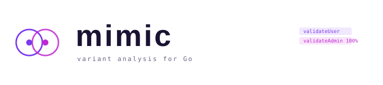
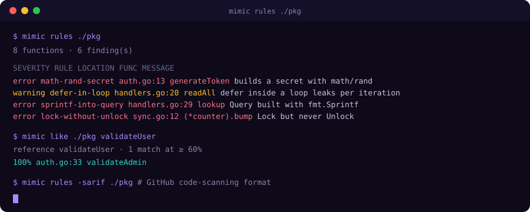
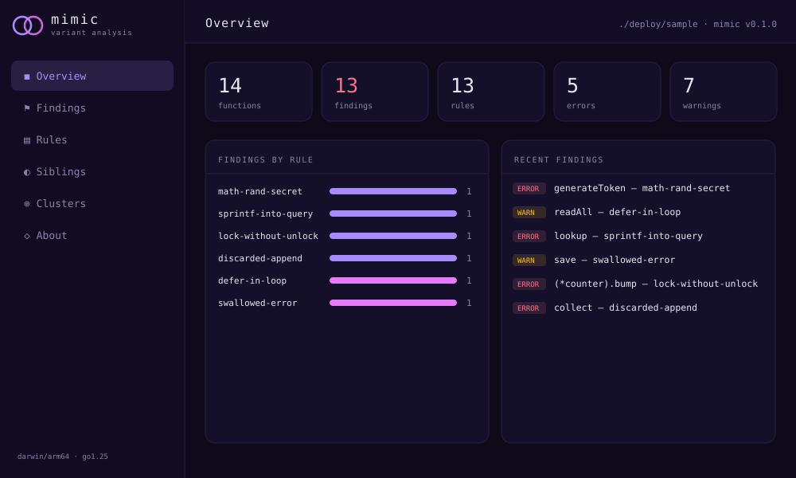
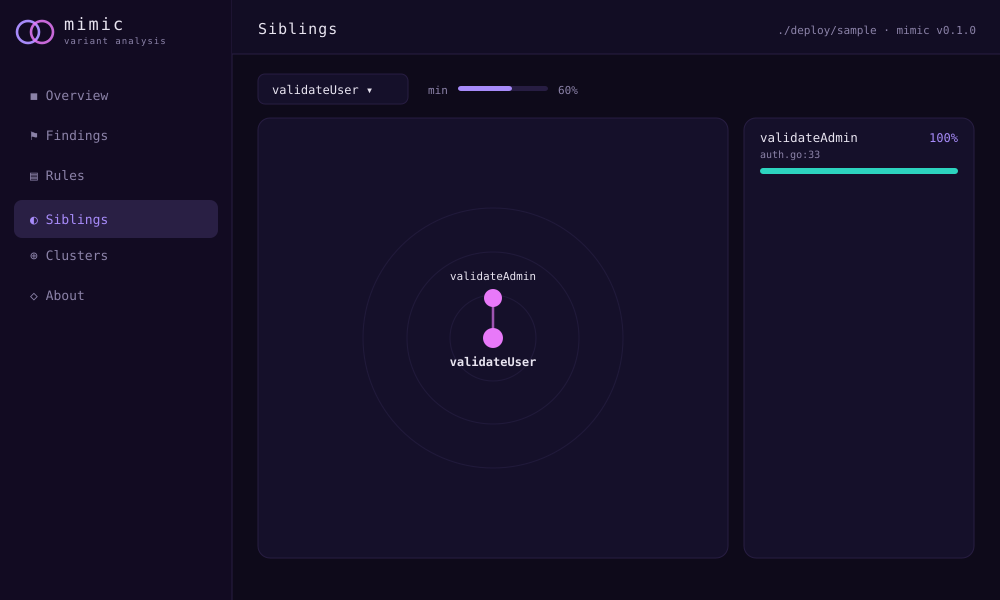

<picture>
  <source media="(prefers-color-scheme: dark)" srcset="docs/assets/wordmark-dark.svg">
  
</picture>

[](https://github.com/cansarihan/mimic/actions/workflows/ci.yml)
[](https://github.com/cansarihan/mimic/actions/workflows/codeql.yml)
[](https://goreportcard.com/report/github.com/cansarihan/mimic)
[](go.mod)
[](LICENSE)

Mimic finds the variants of a known bug. When you fix a bug in one function, its
copy-paste siblings elsewhere still carry it — Mimic ranks the functions that
structurally resemble the one you point it at, so you can go fix them too. It also
runs a set of structural rules that match known-bad shapes outright.

It reads source, not types, so it runs on any Go that parses — no modules to
resolve, no build required. One binary, nothing outside the standard library.

## Two analyses

**Rules** match a shape that is wrong often enough to flag — a `defer` in a loop,
a query built with `fmt.Sprintf`, a mutex locked but never unlocked.

```console
$ mimic rules ./pkg
8 functions · 6 finding(s)

SEVERITY  RULE                 LOCATION         FUNC             MESSAGE
error     math-rand-secret     auth.go:13       generateToken    builds a secret with math/rand's Intn; use crypto/rand
warning   defer-in-loop        handlers.go:20   readAll          defer inside a loop; released only when readAll returns
error     sprintf-into-query   handlers.go:29   lookup           Query receives a fmt.Sprintf-built statement
error     lock-without-unlock  sync.go:12       (*counter).bump  bump calls Lock but never Unlock
```

**Variants** rank the structural siblings of a reference function — a renamed
copy scores ~100%, an edited one lower but still clearly.

```console
$ mimic like ./pkg validateUser
reference validateUser
8 functions scanned · 1 match(es) at ≥ 60%

SIMILARITY  LOCATION       FUNC
100%        auth.go:33     validateAdmin
```



## The panel

`mimic serve` hosts a panel with a sidebar and a page for each view — an overview
dashboard, the findings table, the rule catalogue, the siblings explorer and the
clone clusters.



The Siblings page draws the reference function at the centre of a constellation,
its structural siblings orbiting closer the more alike they are.



## How variants are found

Mimic reduces every function to a structural token stream that ignores names and
literal values, shingles the stream into overlapping windows, and scores two
functions by the Jaccard similarity of their shingle sets. Collapsing identifiers
defeats a rename; shingling tolerates an inserted statement. Run over the whole
tree, the same similarity graph partitions it into clone families:

```console
$ mimic clusters ./pkg -min 0.8
cluster 1 · 2 members
  validateUser   (auth.go:20)
  validateAdmin  (auth.go:33)
```

## SARIF

```console
$ mimic rules -sarif ./pkg > mimic.sarif
```

The rules export as a SARIF 2.1.0 document, so findings flow into GitHub code
scanning and any tool that reads SARIF.

## Rules

```console
$ mimic list
defer-in-loop          a defer inside a loop runs only when the function returns
discarded-append       the result of append is assigned to _; the element is lost
hardcoded-credentials  a secret-named variable is assigned a string literal
lock-without-unlock    a mutex is locked but never unlocked in the same function
math-rand-secret       a secret-sounding function draws from math/rand
regexp-in-loop         a regexp is compiled inside a loop
sprintf-into-query     a SQL statement built with fmt.Sprintf and passed to Query/Exec
swallowed-error        an empty `if err != nil` block drops the failure
unchecked-type-assert  a single-value type assertion panics on a mismatch
```

## Commands

```console
$ mimic rules ./pkg          # run the rules over a tree
    -json            print JSON
    -sarif           print a SARIF 2.1.0 document
    -rule <name>     only run one rule
$ mimic like ./pkg Func      # rank a function's structural siblings
    -min <0..1>      minimum similarity (default 0.6)
$ mimic clusters ./pkg       # group the tree into clone families
    -min <0..1>      minimum similarity (default 0.75)
$ mimic list                 # print the rule catalogue
$ mimic serve -dir ./pkg     # host the panel and API
$ mimic version
```

Flags come before the positional arguments: `mimic like -min 0.8 ./pkg Func`.

## HTTP API

```console
GET /api/v1/status                build info and the directory being analyzed
GET /api/v1/rules                 the rule catalogue
GET /api/v1/findings              every rule finding
GET /api/v1/functions             the functions in the tree
GET /api/v1/like?ref=Func&min=    a reference's siblings
GET /api/v1/clusters?min=         clone families
```

## Run the demo

The demo analyzes a small, deliberately flawed package with one of every rule and
a pair of copy-paste functions.

```sh
cd mimic
make demo          # panel at http://127.0.0.1:18170
make demo-down
```

Or without Docker:

```sh
make run           # serves the panel over the sample package on 127.0.0.1:8080
```

## Build

```sh
make build         # ./bin/mimic
make test          # unit tests
make lint          # golangci-lint
```

Mimic parses source and never runs it.

## License

MIT. See [LICENSE](LICENSE).
