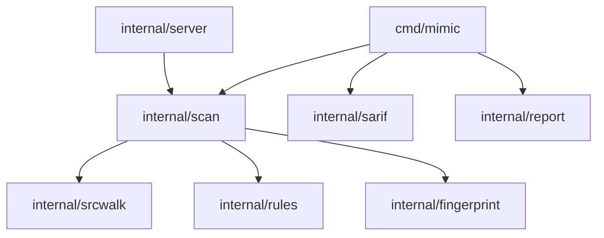

# Architecture

Mimic is a source-level static analyzer with two faces: a set of rules that match
known-bad shapes, and a fingerprint that finds the functions structurally like a
reference. Both run on the same front end, which parses Go and never builds it,
so Mimic works on any source tree that parses — no modules to resolve, no types
to check.

## The two analyses

**Rules.** Each rule is a matcher that inspects one function's AST and reports a
shape that is wrong often enough to be worth a look: a `defer` inside a loop, a
query built with `fmt.Sprintf`, a mutex locked but never unlocked, a secret drawn
from `math/rand`. The rules register themselves, so adding one is a single file.
None of them need type information — they read structure, which is why they run
on code that would not even build.

**Variants.** The other analysis is the one the project is named for. Given a
reference function — often one you just found a bug in — Mimic finds its
siblings. It reduces every function to a structural token stream that ignores
names and literal values, shingles that stream, and ranks the other functions by
the Jaccard similarity of their shingle sets. A renamed copy scores ~100%; an
edited copy scores lower but still stands out. Run over the whole tree, the same
similarity graph partitions the codebase into clone families.

## Packages

- `internal/srcwalk` parses every non-vendored Go file under a directory and
  yields its functions with position information. It is the shared front end.
- `internal/fingerprint` turns a function's AST into a structural token stream,
  shingles it, and scores the similarity of two fingerprints.
- `internal/rules` holds the built-in matchers and the registry they add
  themselves to. Each matcher is independent and tested in isolation.
- `internal/scan` runs the rules over a tree, finds a reference's siblings, and
  clusters the whole tree into clone families with a union-find over the
  similarity graph.
- `internal/sarif` renders a rule scan as a SARIF 2.1.0 document for GitHub code
  scanning and other tools.
- `internal/report` renders results as tables or JSON.
- `internal/server` wraps the analyses in an HTTP API and serves the multi-page
  panel. It reads one fixed directory chosen at startup.

## Why structure, not text

A textual diff of two copy-pasted functions is defeated by a rename; a token
stream that collapses every identifier to one placeholder is not. Shingling the
stream — comparing overlapping windows rather than the whole sequence — tolerates
an inserted statement, so an edited sibling reads as similar rather than
completely different. That is what lets a bug fixed in one function lead to the
copies that still carry it.

## What it does not do

Mimic reads structure, not meaning. It has no type information, so a rule keys on
the shape and names it can see — `db.Query(fmt.Sprintf(...))` is a match whether
or not `db` is really a `*sql.DB`. The rules are triage aids that point a human
at code to read, not a proof. The variant finder compares shape, so two functions
that do very different things with the same control flow can score alike; the
similarity is a ranking, not a claim of equivalence.
